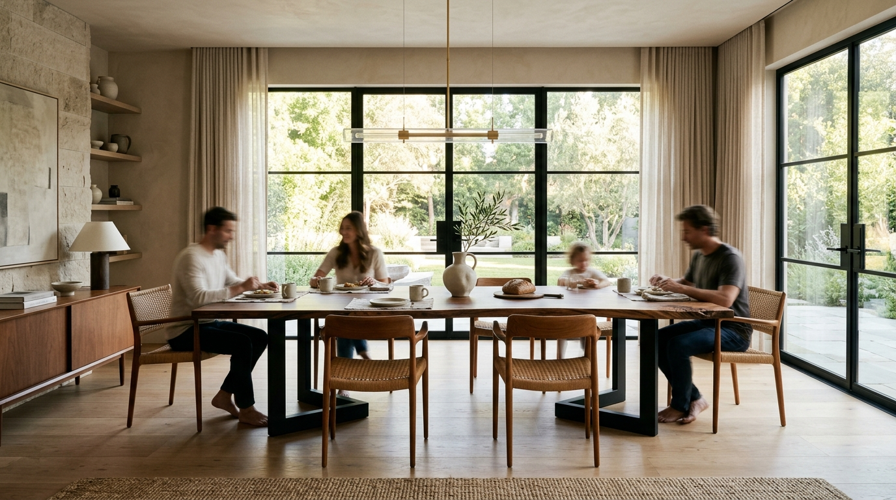

# Atelier & Grain 🪵✨
> **Bespoke Handcrafted Hardwood Furniture & Interactive 3D Configurator Studio**



Atelier & Grain is an architectural luxury e-commerce and custom commission platform for bespoke solid hardwood furniture. Customers can customize live-edge dining tables, sculptural lounge chairs, executive cantilever desks, and organic coffee tables in real-time 3D, selecting certified timbers, hand-rubbed finishes, bases, and bespoke inlays.

---

## 🌟 Key Features

- **Interactive 3D Configurator Engine (Three.js)**:
  - 360° orbit, smooth zoom, and pan controls.
  - Realistic procedural wood grain generation (cathedral grain, annual rings, pore textures).
  - Dynamic lighting modes (Studio Softbox, Warm Golden Hour, Gallery Spotlights).
  - Exploded joinery inspection mode and camera angle presets.
- **Dynamic Pricing Engine**:
  - Live calculations based on hardwood rarity multiplier, custom dimensions, leg materials, edge profiles, and inlays.
  - Seating capacity estimator (e.g., *"Comfortably seats 8–10 guests"*).
  - Monthly financing estimates (0% APR).
- **Curated Timber Library**:
  - 6 sustainably sourced hardwoods: American Black Walnut, European White Oak, Hard Rock Maple, Smoked Japanese Ash, Reclaimed 1890s Chestnut, and Royal Teak.
  - Janka hardness scales, botanical names, and origin provenance.
- **Hand-Rubbed Finish Swatches**:
  - Plant-based zero-VOC hardwax oils (Natural Raw Satin, Warm Amber Honey, Espresso Truffle, Nordic Chalk Washed, Ebonized Obsidian, Vintage Cognac).
- **Commission Management**:
  - Slide-out workshop cart drawer with 50% deposit commission structure.
  - Print-ready architectural spec sheet dossier with high-res 3D snapshot.
  - Free sample swatch box order system.
  - 1-on-1 master woodworker video consultation booking.

---

## 📅 1-Week Full Production Roadmap

| Day | Milestone | Objective & Deliverables |
|:---:|:---|:---|
| **Day 1** | **Core Foundation & 3D Configurator** | ✅ *Completed*: Interactive 3D visualizer, wood/finish/style switcher, live pricing, design system, and responsive layout. |
| **Day 2** | **Augmented Reality (AR) & Room Visualizer** | Add WebXR & USDZ/GLTF model export so clients can view the furniture in their real room using smartphone AR. |
| **Day 3** | **Live Slab Gallery & Grain Explorer** | Integrate an interactive kiln slab selector allowing clients to inspect photographs of actual raw tree trunks in the drying kilns. |
| **Day 4** | **Checkout, Escrow & Payment Gateway** | Stripe escrow integration (50% upfront deposit, 50% upon white-glove inspection), invoice generation, and Affirm financing integration. |
| **Day 5** | **Client Workshop Portal & Build Tracking** | "Track My Commission" portal where clients view photographic updates of their piece moving through sawing, shaping, and oiling. |
| **Day 6** | **SEO, Analytics & Performance Optimization** | Schema.org Product structured data, OpenGraph cards, image WebP conversion, and sub-second page loads. |
| **Day 7** | **Final Quality Assurance, White-Glove Logistics & Launch** | Full end-to-end device testing, custom domain connection (e.g., `ateliergrain.com`), and production deployment (Vercel/Netlify/Cloudflare). |

---

## 🚀 Getting Started Locally

```bash
# Clone the repository
git clone https://github.com/Kirtanx3/furniture.git

# Enter project directory
cd furniture

# Start local server
npm start
# Server runs at http://localhost:3000
```

---

## 🛠️ Technology Stack

- **Core**: Semantic HTML5, Vanilla JavaScript (ES6+), Vanilla CSS3 (Custom Properties & Glassmorphism)
- **3D Graphics Engine**: Three.js (r128), OrbitControls, Procedural Canvas Shaders
- **Icons & Typography**: Font Awesome 6 Pro, Playfair Display, Plus Jakarta Sans, Space Grotesk
- **Dev Server**: Node.js HTTP server (Zero runtime dependencies)

---

&copy; 2026 Atelier & Grain Bespoke Woodworks LLC. Licensed under the MIT License.
